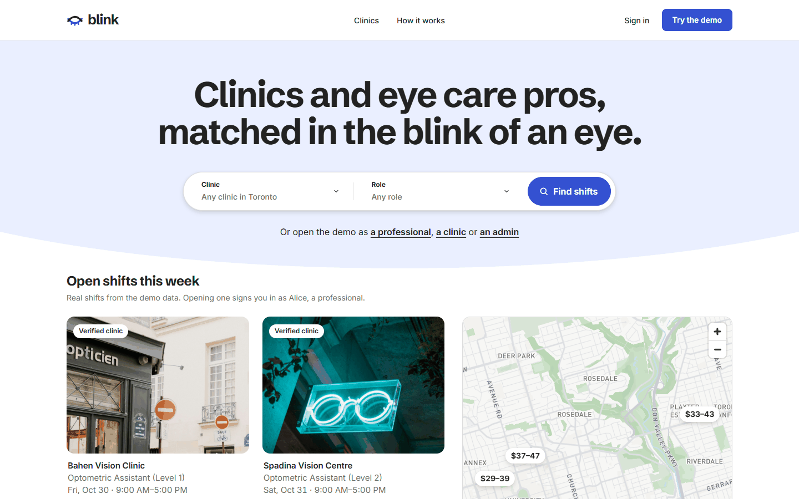
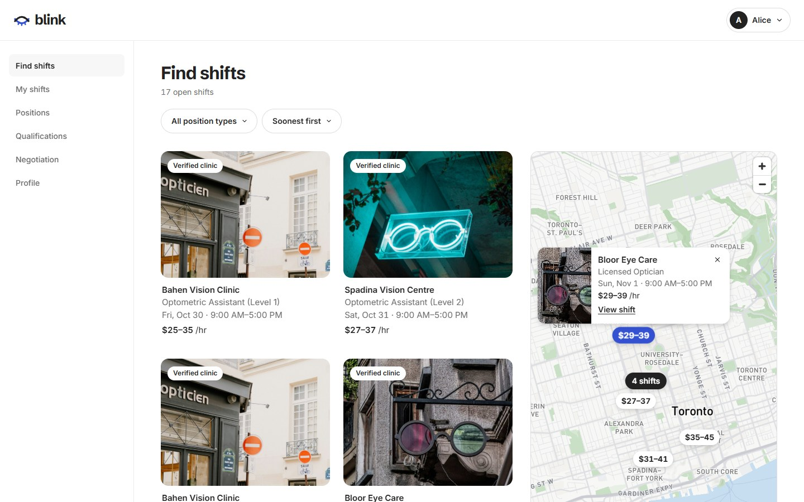
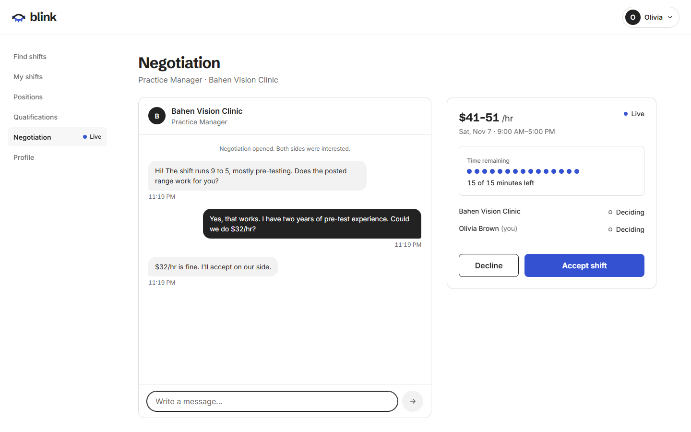

# Blink

**Clinics and eye care pros, matched in the blink of an eye.**

Blink is a full-stack staffing platform for optometry. Clinics post short-notice shifts, verified eye care professionals raise a hand, and when interest is mutual both sides get one live, 15-minute negotiation room to agree on the rate. If both accept, the shift is filled.



## Highlights

- **Real-time negotiation.** Mutual interest opens a Socket.IO chat with a shared 15-minute clock, shown as 15 dots that fade one per minute. Both sides accept or decline, and the shift fills the moment both accept.
- **Credential verification.** Professionals upload documents per position; an admin reviews each one before clinics can see that professional.
- **Map-first shift search.** Photo cards beside a Mapbox map with price pills, clustering, and hover sync between cards and pins.
- **Three roles, one app.** Professional, clinic and admin dashboards, each with one-click demo sign-in.
- **A considered design system.** Iris and Sky palette, eight line illustrations, a logo that blinks, and eye-chart lettering in a few quiet places. See [DESIGN.md](DESIGN.md).





## Try the demo

Run it locally (below), open the home page and pick **a professional**, **a clinic** or **an admin**. The seed script creates these accounts; every password is `123123`.

| Role | Email |
|------|-------|
| Eye care professional | `regular1@blink.dev` to `regular20@blink.dev` |
| Clinic | `business1@blink.dev` to `business15@blink.dev` |
| Admin | `admin1@blink.dev` |

The clinics are fictional seed data with Toronto street addresses. Demo data resets when you re-run the seed.

## Features

### Professionals
- Find shifts by position type and start date, on a list or the map
- Raise a hand with "I'm interested" and track interests, invitations and work history
- Upload credential documents per position and follow their review status
- Negotiate in a live chat room with a shared 15-minute clock

### Clinics
- Post shifts with a position type, an hourly range and a time window
- Browse candidates with approved qualifications and invite them
- See who is interested, start a negotiation and confirm the hire

### Admins
- Review and approve or reject credential documents
- Verify clinics, suspend users and manage position types
- Configure system settings: negotiation window, reset cooldown, job start window and availability timeout

### Public
- A clinic directory with search, sort and a map
- Clinic profiles with contact details, location and upcoming open shifts

### Accounts
- JWT authentication with role-based dashboards
- Account activation and password reset flows
- Sign-up for professionals and clinics

## Tech stack

| Layer | Technology |
|-------|-----------|
| Frontend | React 19, TypeScript, Vite, React Router |
| Backend | Node.js, Express, Prisma ORM, SQLite |
| Real time | Socket.IO |
| Auth | JWT |
| Validation and security | Zod, Helmet, express-rate-limit |
| Maps | Mapbox GL JS with the Mapbox Standard style; MapLibre GL JS with OpenFreeMap tiles as a keyless fallback |
| Type | Schibsted Grotesk and Inter (self-hosted with Fontsource), Optician Sans for eye-chart lettering |

## Getting started

### Prerequisites
- Node.js 22 or later
- npm

### Install

```bash
# backend dependencies and database
cd backend
npm install
npx prisma generate
npx prisma db push
npx prisma db seed

# frontend dependencies
cd ../frontend
npm install

# root dependencies (for the combined dev script)
cd ..
npm install
```

### Environment

Copy `backend/.env.example` to `backend/.env`:

```
JWT_SECRET=your-secret-key-here
FRONTEND_URL=http://localhost:5173
NODE_ENV=development
```

Copy `frontend/.env.example` to `frontend/.env`:

```
VITE_BACKEND_URL=http://localhost:3000
VITE_MAPBOX_TOKEN=
```

Maps use Mapbox when `VITE_MAPBOX_TOKEN` is set. Create a free public token (it starts with `pk.`) at [mapbox.com](https://account.mapbox.com/access-tokens/) and restrict it to your site URLs. Without a token, maps fall back to MapLibre with OpenFreeMap tiles, so the app still works.

### Run

From the repository root, start the backend (port 3000) and the frontend (port 5173) together:

```bash
npm run dev
```

Then open http://localhost:5173. To reset the demo data, run `npm run seed` in `backend`.

### Checks

```bash
npm run lint           # eslint on the frontend
npm run format:check   # prettier on frontend and backend
cd frontend && npx tsc -b && npx vite build
```

## Project structure

```
.
├── backend/
│   ├── prisma/          # schema and seed data
│   ├── src/
│   │   ├── config/      # environment configuration
│   │   ├── controllers/ # route handlers
│   │   ├── middleware/  # auth, validation, rate limiting, uploads
│   │   ├── routes/      # Express routes
│   │   ├── services/    # business logic
│   │   └── validators/  # Zod schemas
│   └── uploads/         # uploaded avatars, resumes and documents
├── frontend/
│   ├── public/          # favicon and clinic photos
│   └── src/
│       ├── assets/      # self-hosted fonts
│       ├── components/  # shared UI: Logo, Select, ClinicMap, Illustration, ...
│       ├── contexts/    # auth and negotiation providers
│       ├── hooks/
│       ├── pages/       # pages by role: Public, Auth, Regular, Business, Admin
│       └── utils/       # API client and helpers
├── docs/screenshots/    # README images
├── DESIGN.md            # the design system
└── PRODUCT.md           # product and brand context
```

## Security

- Tiered rate limiting for auth, uploads, public and signed-in routes
- Zod validation on every route, with JSON error responses
- Helmet security headers with a strict Content Security Policy
- Admin-only system settings and upload size limits
- Per-connection message rate limiting on Socket.IO

## Credits

### Fonts
- [Schibsted Grotesk](https://fonts.google.com/specimen/Schibsted+Grotesk) and [Inter](https://rsms.me/inter/), self-hosted with Fontsource.
- [Optician Sans](https://github.com/anewtypeofinterference/Optician-Sans) by ANTI Hamar and Fábio Duarte Martins, a typeface rebuilt from historical eye-chart letters. Used under the SIL Open Font License 1.1 (`frontend/src/assets/fonts/OFL.txt`).

### Maps
Map data © [OpenStreetMap](https://www.openstreetmap.org/copyright) contributors, styled by [Mapbox](https://www.mapbox.com/), with [OpenFreeMap](https://openfreemap.org/) as the fallback.

### Photos
The clinic photos in `frontend/public/photos/clinics/` are illustrative stock photos of optical shop fronts, windows and signs from [Unsplash](https://unsplash.com), used under the [Unsplash License](https://unsplash.com/license). Each seeded clinic has one fixed photo, cropped to 4:3. The clinics are fictional, and the photos do not show the buildings at their addresses.

| File | Photographer | Source |
|------|--------------|--------|
| `bahen-vision-clinic.jpg` | Annie Spratt | [Unsplash](https://unsplash.com/photos/street-corner-with-optician-shop-and-bicycles-06g9ZCVDnhg) |
| `spadina-vision-centre.jpg` | Zuzanna Adamczyk | [Unsplash](https://unsplash.com/photos/white-hippie-glasses-neon-light-decor-on-door-smbcpZ0OvRs) |
| `bloor-eye-care.jpg` | Carlos Torres | [Unsplash](https://unsplash.com/photos/a-building-that-has-a-bunch-of-windows-on-it--Va3CiFtsYU) |
| `king-west-optometry.jpg` | Isaac Owens | [Unsplash](https://unsplash.com/photos/person-in-doorway-of-optician-shop-rOC-_ssUw2o) |
| `danforth-vision-studio.jpg` | Samuel Regan-Asante | [Unsplash](https://unsplash.com/photos/a-building-with-a-sign-that-says-sungglasses-on-it-mKgj3VawOT0) |
| `queen-street-eyecare.jpg` | adrien lopes | [Unsplash](https://unsplash.com/photos/stylish-sunglasses-displayed-in-a-shop-window-WDT_HvnMyh0) |
| `yorkville-optometry-group.jpg` | Alexander Zvir | [Unsplash](https://unsplash.com/photos/hats-and-sunglasses-in-shop-window-YZBXj3k03aU) |
| `college-vision-clinic.jpg` | Joel Ambass | [Unsplash](https://unsplash.com/photos/red-neon-sign-reading-eye-exams-EM7A3xWfgqE) |
| `harbourfront-eye-care.jpg` | martin lea | [Unsplash](https://unsplash.com/photos/neon-glasses-sign-on-brick-wall-lm3MpmxRFCw) |
| `cssu-eyecare.jpg` | Emily Barnett | [Unsplash](https://unsplash.com/photos/a-building-with-a-neon-sign-on-the-side-of-it-5ihfJUEJUIM) |
| `annex-vision-studio.jpg` | Alexander Zvir | [Unsplash](https://unsplash.com/photos/hats-and-sunglasses-in-shop-window-9tIr-qYLGUs) |
| `rosedale-optometry.jpg` | Hoai Nam Mai | [Unsplash](https://unsplash.com/photos/street-view-of-buildings-with-an-optician-sign-wTIFfgG1saU) |
| `liberty-village-eye-centre.jpg` | B C | [Unsplash](https://unsplash.com/photos/neon-sign-shaped-like-glasses-at-night-NBIjuClLAW0) |
| `leslieville-vision-care.jpg` | lesha tuman | [Unsplash](https://unsplash.com/photos/optician-shop-sign-with-sunglasses-logo-ql_w4SwGKaM) |
| `midtown-eye-centre.jpg` | Alexander Zvir | [Unsplash](https://unsplash.com/photos/hats-and-sunglasses-on-wire-mannequins-mFTM9nSMzJQ) |

## Background

Blink began as DentaLink, a dental staffing platform built for a University of Toronto web programming course (CSC309). It was later adapted to optometry, then rebuilt with a new brand, design system and map-first search.

## License

MIT. See [LICENSE](LICENSE).
