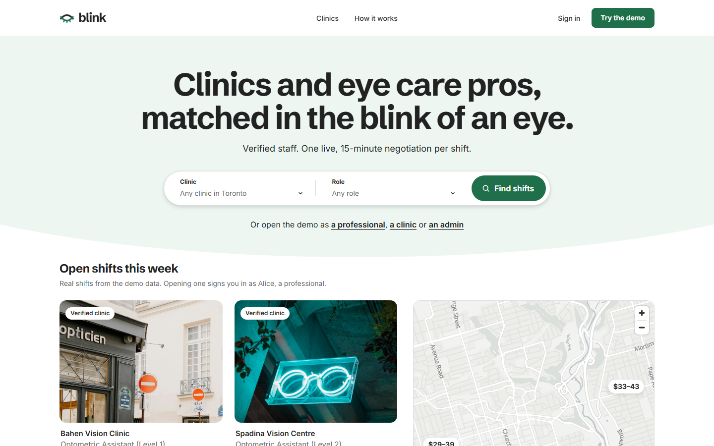
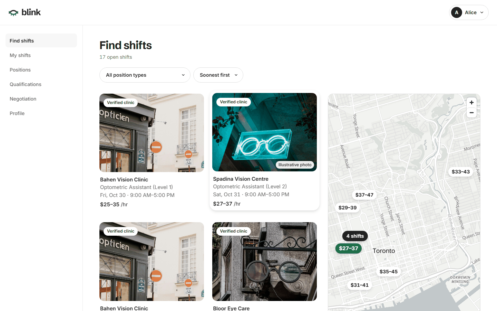
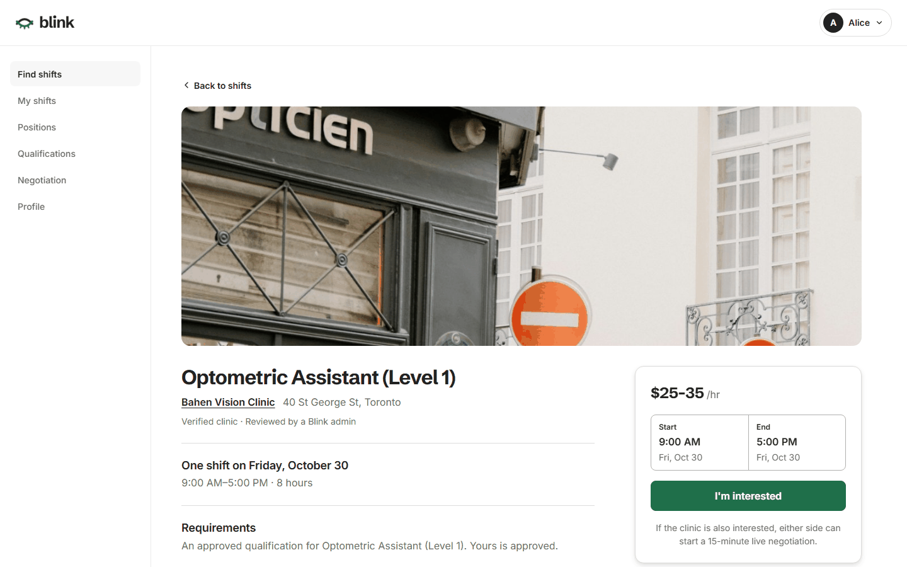
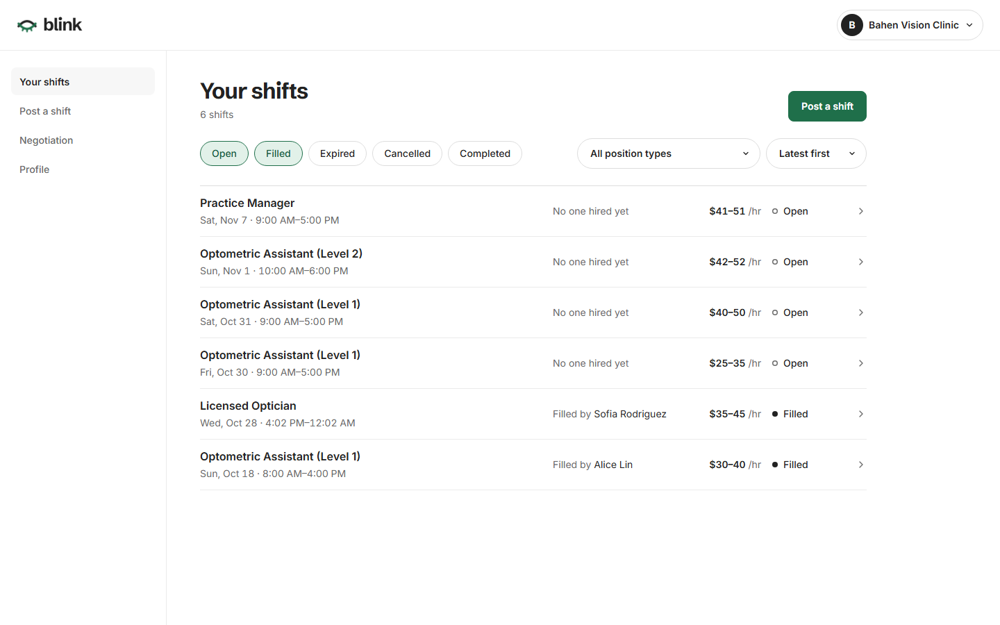
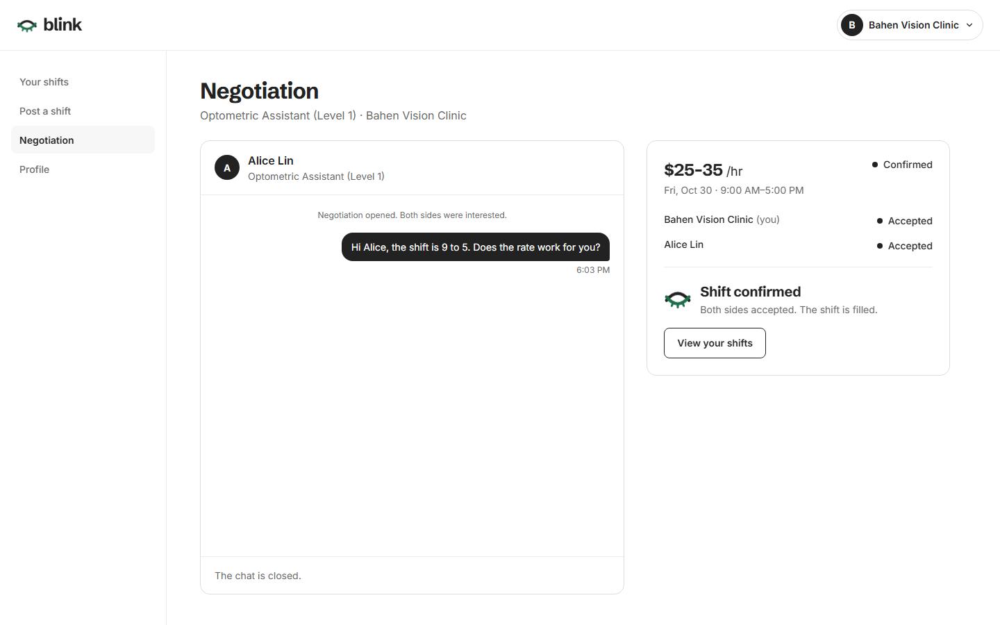
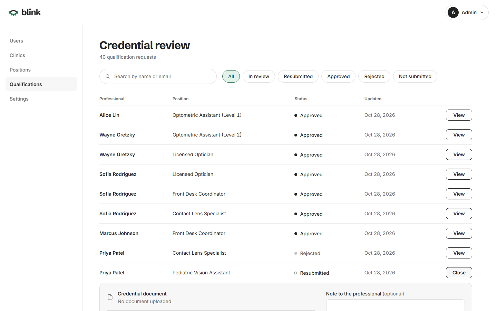

# Blink

A real-time optometry staffing platform connecting qualified eye care professionals with clinics that need them. Built with React, Express.js, Prisma, and Socket.IO.



## Demo accounts

The seed script (`npx prisma db seed`) creates these accounts. All accounts use the password `123123`.

| Role | Email |
|------|-------|
| Optometry professional | `regular1@blink.dev` through `regular20@blink.dev` |
| Optometry clinic | `business1@blink.dev` through `business15@blink.dev` |
| Platform admin | `admin1@blink.dev` |

## Features

### For optometry professionals
- Browse open shifts with filtering by position type, salary range, and start date
- Manage qualifications and upload credential documents for admin review
- Express interest in jobs and receive invitations from clinics
- Real-time negotiation chat with 15-minute time-boxed windows






### For optometry clinics
- Post shifts with position type, salary range, and time window
- Browse discoverable candidates filtered by approved qualifications
- Invite candidates and track mutual interest
- Negotiate terms in real time and confirm hires





### For platform administrators
- Manage users (suspend/unsuspend) and businesses (verify/unverify)
- Review and approve qualification submissions
- Configure system settings: negotiation window, reset cooldown, job start window, availability timeout
- Manage position types




### Public pages
- Browse verified optometry clinics with search and sorting
- View clinic profiles with location map, contact info, and open positions

### Authentication
- JWT-based auth with role-dependent dashboards
- Account activation via email token
- Password reset flow
- Registration for both professionals and clinics


## Tech stack

| Layer | Technology |
|-------|-----------|
| Frontend | React 19, TypeScript, Vite, React Router |
| Backend | Express.js, Prisma ORM, SQLite |
| Real-time | Socket.IO (WebSocket) |
| Auth | JWT (JSON Web Tokens) |
| Maps | MapLibre GL JS + OpenFreeMap (OpenStreetMap data) |
| Fonts | Schibsted Grotesk and Inter, self-hosted with Fontsource |
| Security | Helmet, express-rate-limit, Zod validation |

## Getting started

### Prerequisites
- Node.js 22+
- npm

### Installation

```bash
# install backend dependencies and set up the database
cd backend
npm install
npx prisma generate
npx prisma db push
npx prisma db seed

# install frontend dependencies
cd ../frontend
npm install

# install root dependencies (for the combined dev script)
cd ..
npm install
```

### Environment

Copy `backend/.env.example` to `backend/.env` and fill in values:

```
JWT_SECRET=your-secret-key-here
FRONTEND_URL=http://localhost:5173
NODE_ENV=development
```

Create `frontend/.env` so the Vite dev server sends API requests to the backend:

```
VITE_BACKEND_URL=http://localhost:3000
```

### Running locally

Start the backend and frontend together from the repository root:

```bash
npm run dev
```

Or start each one in its own terminal:

```bash
# terminal 1: start backend (port 3000)
cd backend
node --watch src/server.js 3000

# terminal 2: start frontend (port 5173)
cd frontend
npm run dev
```

Open http://localhost:5173.

## Project structure

```
.
├── backend/
│   ├── prisma/          # schema, migrations, seed
│   ├── src/
│   │   ├── config/      # environment configuration
│   │   ├── controllers/ # route handlers
│   │   ├── middleware/  # auth, validation, rate limiting, upload
│   │   ├── routes/      # express route definitions
│   │   ├── services/    # business logic
│   │   └── validators/  # zod schemas
│   └── uploads/         # user-uploaded files (avatars, resumes, docs)
├── frontend/
│   └── src/
│       ├── components/  # reusable UI components
│       ├── contexts/    # React context providers (auth, negotiation)
│       ├── pages/       # page-level components by role
│       └── utils/       # API client, helpers
└── docs/
    └── screenshots/     # application screenshots
```

## Security

- Tiered rate limiting on all endpoints (auth, upload, public, authenticated)
- Strict input validation with Zod schemas on every route
- Centralized secret management with startup validation in production
- Helmet security headers
- File upload size limits
- Socket.IO per-connection message rate limiting

## Photo credits

The clinic photos in `frontend/public/photos/clinics/` are illustrative stock photos of optical shop fronts, windows and signs from [Unsplash](https://unsplash.com), used under the [Unsplash License](https://unsplash.com/license). Each seeded clinic has one fixed photo, cropped to 4:3. The clinics are fictional, and the photos do not show the buildings at their addresses.

| File | Photographer | Source |
|------|--------------|--------|
| `bahen-vision-clinic.jpg` | Annie Spratt | [Unsplash](https://unsplash.com/photos/street-corner-with-optician-shop-and-bicycles-06g9ZCVDnhg) |
| `spadina-vision-centre.jpg` | Zuzanna Adamczyk | [Unsplash](https://unsplash.com/photos/white-hippie-glasses-neon-light-decor-on-door-smbcpZ0OvRs) |
| `bloor-eye-care.jpg` | Carlos Torres | [Unsplash](https://unsplash.com/photos/a-building-that-has-a-bunch-of-windows-on-it--Va3CiFtsYU) |
| `king-west-optometry.jpg` | Isaac Owens | [Unsplash](https://unsplash.com/photos/person-in-doorway-of-optician-shop-rOC-_ssUw2o) |
| `danforth-vision-studio.jpg` | Samuel Regan-Asante | [Unsplash](https://unsplash.com/photos/a-building-with-a-sign-that-says-sungglasses-on-it-mKgj3VawOT0) |
| `queen-street-eyecare.jpg` | adrien lopes | [Unsplash](https://unsplash.com/photos/stylish-sunglasses-displayed-in-a-shop-window-WDT_HvnMyh0) |
| `yorkville-optometry-group.jpg` | Alexander Zvir | [Unsplash](https://unsplash.com/photos/hats-and-sunglasses-in-shop-window-YZBXj3k03aU) |
| `college-vision-clinic.jpg` | Joel Ambass | [Unsplash](https://unsplash.com/photos/red-neon-sign-reading-eye-exams-EM7A3xWfgqE) |
| `harbourfront-eye-care.jpg` | martin lea | [Unsplash](https://unsplash.com/photos/neon-glasses-sign-on-brick-wall-lm3MpmxRFCw) |
| `cssu-eyecare.jpg` | Emily Barnett | [Unsplash](https://unsplash.com/photos/a-building-with-a-neon-sign-on-the-side-of-it-5ihfJUEJUIM) |
| `annex-vision-studio.jpg` | Alexander Zvir | [Unsplash](https://unsplash.com/photos/hats-and-sunglasses-in-shop-window-9tIr-qYLGUs) |
| `rosedale-optometry.jpg` | Hoai Nam Mai | [Unsplash](https://unsplash.com/photos/street-view-of-buildings-with-an-optician-sign-wTIFfgG1saU) |
| `liberty-village-eye-centre.jpg` | B C | [Unsplash](https://unsplash.com/photos/neon-sign-shaped-like-glasses-at-night-NBIjuClLAW0) |
| `leslieville-vision-care.jpg` | lesha tuman | [Unsplash](https://unsplash.com/photos/optician-shop-sign-with-sunglasses-logo-ql_w4SwGKaM) |
| `midtown-eye-centre.jpg` | Alexander Zvir | [Unsplash](https://unsplash.com/photos/hats-and-sunglasses-on-wire-mannequins-mFTM9nSMzJQ) |

## License

MIT — see [LICENSE](LICENSE).
